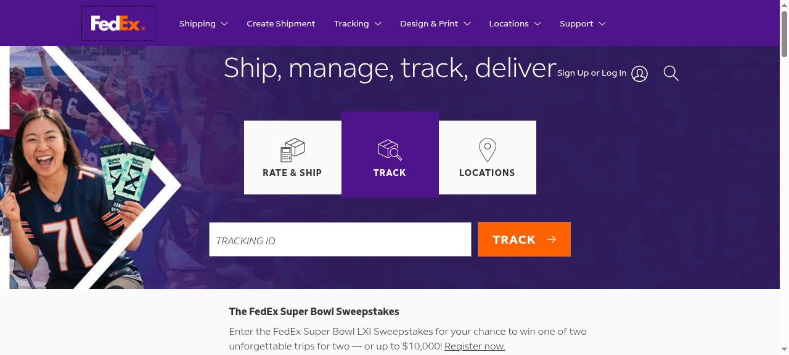

# Shipping Front End — Rate, Ship, Track

A shipping-company front end built around the three things customers actually come for: get a rate, create a shipment, track a parcel.

**[→ View the live site](https://fedex-brown.vercel.app/)**



## What this is

Most logistics sites bury the useful tools under marketing. This build does the opposite — the three things a customer actually arrives for are the first three things on the page.

Rate calculator, shipment creation and parcel tracking are all up front, with a location finder and a high-contrast layout that holds up on a phone.

## What's inside

- Rate calculator
- Shipment creation flow
- Parcel tracking
- Location finder
- High-contrast, mobile-first layout
- Fully self-contained static build

## Technology

- HTML, CSS and JavaScript
- Static site — no build step required
- Deployed on Vercel and GitHub Pages

## Run it locally

No build step, no dependencies — it's plain HTML, CSS and JavaScript.

```bash
# from the repository root
python3 -m http.server 8000
# then open http://localhost:8000
```

Or just open `index.html` directly in a browser.

## Note

A front-end study build. All brand marks belong to their respective owners; the interface work is what this repository demonstrates.


---

<sub>Built by **[Benito K Chukwuemeka](https://github.com/Ebubechineka)** · [Golden Vista Global](https://goldenvistaglobal.vercel.app/) — business websites, landing pages and web apps for clients in Nigeria and worldwide.</sub>
